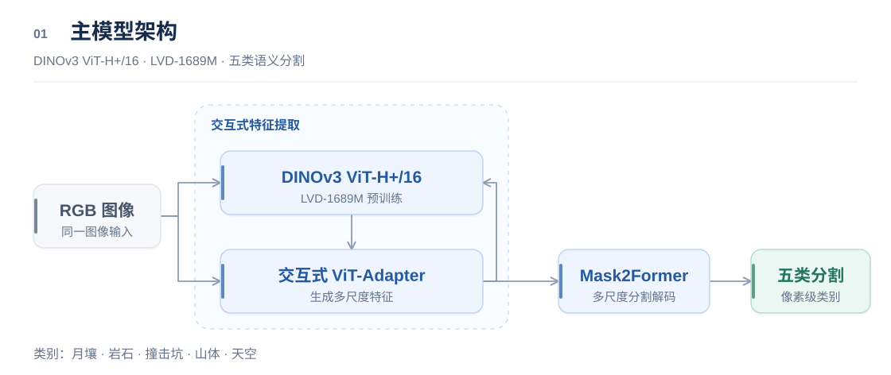
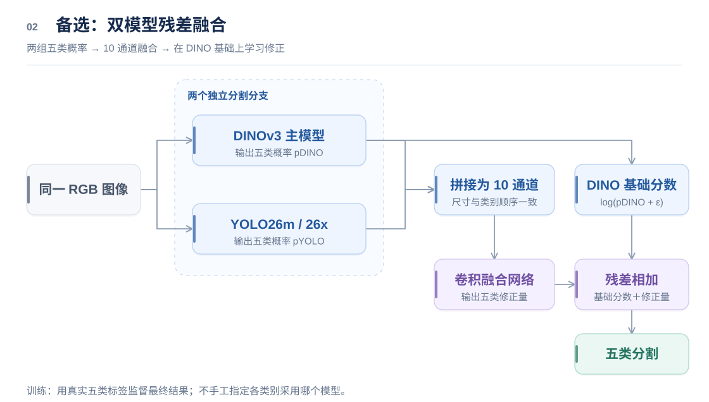
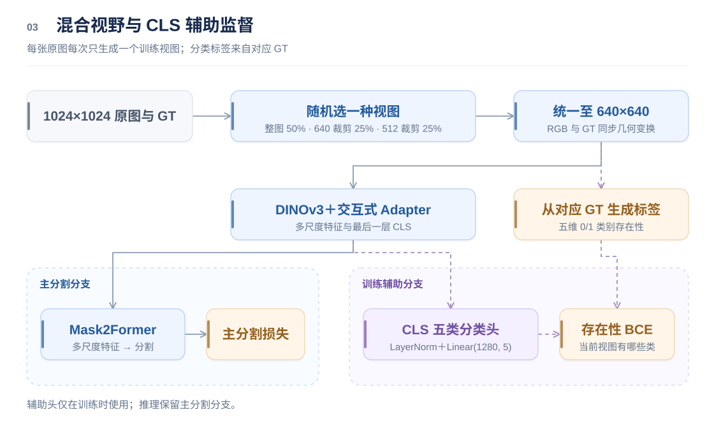
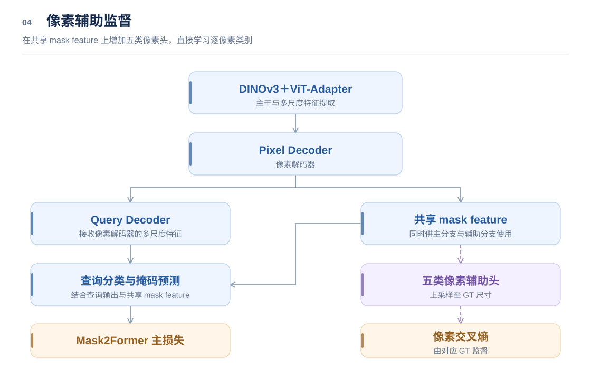
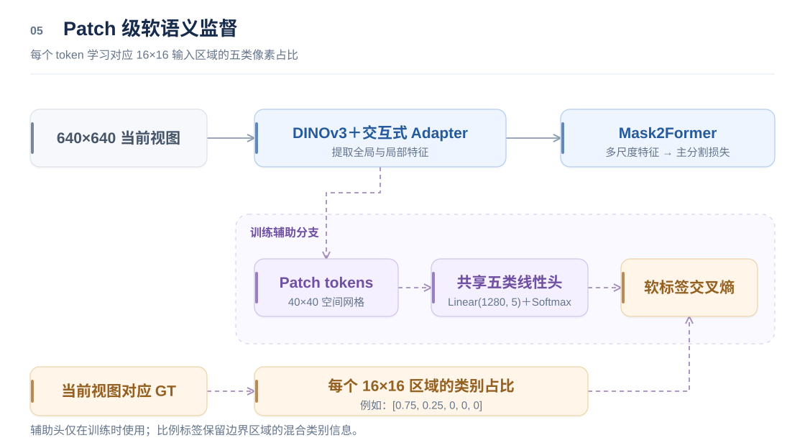
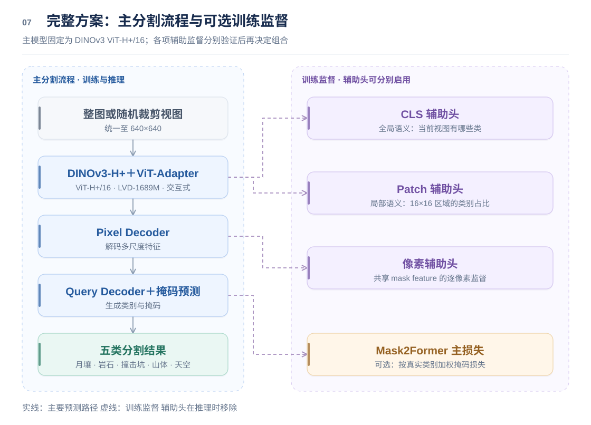

# MoonSeg 五类语义分割方案


## 1. 主模型：DINOv3＋ViT-Adapter＋Mask2Former

采用 **DINOv3 ViT-H+/16（LVD-1689M）＋ ViT-Adapter＋Mask2Former** 作为主模型。DINOv3 提取图像特征，Adapter 生成多尺度特征，Mask2Former 输出五类分割。



### 1.1 主模型的选择依据

下面为了方便短测以及和我之前已经实验过的模型效果做对比，继续采用场景5固定 400 张验证集，其余 1、3、6、7、8 作为训练，还没有测试过刚公布的测试集（同时场景5也是在训练集中最难的，如果它的分能提高一般整体也会提高，比较有代表性）。各实验训练设置不同比如学习率、批次等等，只是用于简单筛选方向。
以下这些实验的模型是在看近两年这类语义分割比赛中比较常见的，试了下效果都不错，实际方案打算采用 DINOv3 ViT-H+/16，实验只采用参数量小一些的DINOv3-L进行探索。

| 实验 | 初始权重 | mIoU | 岩石 IoU | 撞击坑 IoU | 山体 IoU |
| --- | --- | ---: | ---: | ---: | ---: |
| DINOv3-L＋SimpleFPN＋Mask2Former | 骨干：DINOv3 ViT-L/16，LVD-1689M；SimpleFPN 和 Mask2Former 随机初始化 | 88.07 | 78.72 | 82.67 | 81.29 |
| DINOv3-L＋ViT-Adapter＋Mask2Former | 骨干：DINOv3 ViT-L/16，LVD-1689M；ViT-Adapter 和 Mask2Former 随机初始化 | 88.57 | 77.00 | 81.01 | 87.07 |
| DINOv3-L＋ViT-Adapter＋Mask2Former，ADE20K权重  | 骨干：DINOv3 ViT-L/16，LVD-1689M；Adapter 和 Mask2Former：BEiT-L/16＋ViT-Adapter-L 的 ADE20K 权重（见1.2表格第一行） | **90.35** | **78.72** | **86.54** | **88.34** |
| Swin-L＋Mask2Former，ADE20K 权重 | Swin-L＋Mask2Former 官方 ADE20K 语义分割权重，骨干上游为 ImageNet-21K（见1.2表格第二行） | 85.68 | 72.02 | 80.86 | 77.86 |
| 原始 YOLO26m，1024 单尺度 | YOLO26m-sem 官方 Cityscapes 语义分割权重 `yolo26m-sem.pt`，上游为 COCO 实例分割初始化 | 87.43 | 74.13 | 85.38 | 79.20 |

SimpleFPN 和原 Adapter 两组未加载分割预训练权重；90.35% 一组迁移第 1.2 节 A 的参数。Swin-L 一组使用第 1.2 节 B 的完整网络。各组随后均在 MoonSeg 训练集上训练。

**这些实验主要为了快速测效果。DINO 与 Swin 实验冻结了编码器，训练配方也未充分优化，因此结果只说明当前设置下的表现，不能代表完整微调后的模型上限。** 


### 1.2 模型版本、预训练集与权重来源

**执行配置：DINOv3 ViT-H+/16骨干使用 LVD-1689M 权重，vit-Adapter 和 Mask2Former 也有官方公开的预训练权重！优先采用官方公开的预训练权重效果更好（见下表，共找到两个公开版本）。** 

| 采用模块 | 明确版本 | 上游预训练 → 分割训练数据集 | 权重标识与来源 | 迁移到 H+ 主模型的适配 | 使用案例 |
| --- | --- | --- | --- | --- | --- |
|  |
| ViT-Adapter-L＋Mask2Former | BEiT-L/16＋ViT-Adapter-L＋Mask2Former，640、160k，发布版 v0.2.2 | BEiT-L：ImageNet-22K → ADE20K 语义分割 | [`mask2former_beit_adapter_large_640_160k_ade20k.zip`](https://github.com/czczup/ViT-Adapter/releases/download/v0.2.2/mask2former_beit_adapter_large_640_160k_ade20k.zip) | 去掉 BEiT 骨干；保留兼容的 Adapter、Mask2Former 权重；Adapter 适配 H+ 的 1280 维特征，分类头改为五类＋无目标 | 我在 DINOv3-L 实验中使用；相比分割模块随机初始化，mIoU 提高 **1.77 个百分点** |
| Mask2Former | Swin-L，patch 4、window 12、384 规格＋Mask2Former，640、160k | Swin-L：ImageNet-21K → ADE20K 语义分割 | [`facebook/mask2former-swin-large-ade-semantic`](https://huggingface.co/facebook/mask2former-swin-large-ade-semantic) | 去掉 Swin 骨干；保留兼容的 Mask2Former 权重；新增 H+ Adapter 和输入投影，分类头改为五类＋无目标 | ICRA 2026 GOOSE 第一名用于 Mask2Former 初始化（[技术报告](https://arxiv.org/html/2606.18582v1)；未披露具体权重文件名） |
 |


两种初始化来源可分别验证看哪个效果更好，主骨干均使用 **DINOv3 ViT-H+/16（LVD-1689M）**。第一行优先验证「保留 1024 维 Adapter＋双向投影」，同时保留原生 1280 维 Adapter 作为对照，暂不确定哪种效果更好。

- **第一行：ViT-Adapter-L＋Mask2Former**。去掉 BEiT 骨干，保留 Adapter 和 Mask2Former 的 1024 维结构及兼容权重；通过 1280→1024 投影接收 H+ 特征，通过 1024→1280 投影向 H+ 回注残差信息。新增投影重新初始化，与 Adapter 一起训练。或者将 Adapter 改为 1280 维，不兼容参数重新初始化；通过输出投影连接同一份 1024 维 Mask2Former。以上方式仅供参考。
- **第二行：Mask2Former**。去掉 Swin 骨干，只迁移兼容的 Mask2Former 权重；交互式 Adapter 和输入投影重新初始化。
- **共同修改**。保留所选来源的解码器宽度；类别输出改为五类，并保留查询分类所需的「无目标」类别。


## 2. 备选：DINOv3 与 YOLO26m 学习式融合

早期实验结果发现中YOLO26m-sem 的撞击坑分类结果优于DINOv3-L＋SimpleFPN＋Mask2Former（权重随机初始化版）方案，因此考虑让两个模型互补。迁移实验官方公开的ADE20K 权重后，DINO 自身的撞击坑结果已明显提高，因此**融合不一定有价值，看后续完整实验有没有必要吧**。
做了yolo26系列更大参数的**YOLO26x 补充实验。** 使用 YOLO26x-sem（x 规模语义分割版），分别从官方 Cityscapes 权重 `yolo26x-sem.pt` 和 ADE20K 权重 `yolo26x-sem-ade20k.pt` 初始化，再训练 MoonSeg 五类。以下均为 Moon_5 固定 400 张、1024 整图单尺度推理的最佳 EMA 记录，单位为 %。

| 模型与分割预训练来源 | mIoU | 岩石 IoU | 撞击坑 IoU | 山体 IoU | 最佳轮次／已记录轮数 |
| --- | ---: | ---: | ---: | ---: | ---: |
| [YOLO26m-sem，Cityscapes](../runs/yolo26m_sem_b16_lr3e4_e20/history.jsonl) | 87.43 | 74.13 | 85.38 | 79.20 | 6／20 |
| [YOLO26x-sem，Cityscapes](../runs/yolo26x_cityscapes_originalrecipe_b16_lr3e4_e20_20261112/history.jsonl) | 82.86 | 62.72 | 88.74 | 64.13 | 4／10 |
| [YOLO26x-sem，ADE20K](../runs/yolo26x_ade20k_enc3e5_head3e4_warm2_e20_20261112/history.jsonl) | 82.15 | 62.82 | 85.31 | 64.02 | 5／8 |

结果发现整体 mIoU 比 m 版低 **4.57 个百分点**。
Cityscapes 组沿用原始 m 版训练配方；ADE20K 组采用编码器／分割头分组学习率。官方验证集是x比m版高了一点多各百分点，我不好说本次实验效果x版更低的原因（ai也没分析出什么来，实验已调整学习率），结论是目前不适合直接替代 m 版。


融合输入采用同一图像的两组五类概率，统一空间尺寸和类别顺序后拼成 10 通道。卷积网络学习如何修正 DINO 的结果，由真实五类标签监督最终输出。



融合网络可从以下结构起步，前三层卷积后使用 GELU：

```text
3×3 Conv：10 → 32 → GELU
3×3 Conv：32 → 64 → GELU
3×3 Conv：64 → 32 → GELU
1×1 Conv：32 → 5
```

采用残差输出：

$$
z_{\mathrm{final}}=\log(p_{\mathrm{DINO}}+\epsilon)+F(p_{\mathrm{DINO}},p_{\mathrm{YOLO}})
$$

其中，DINO 的语义分数先按类别归一化为概率；融合网络最后一层零初始化，使起点接近 DINO。网络可以学习减少误检、补回漏检，也可以修正其他类别，不手工规定撞击坑必须采用 YOLO 的判断。

## 3. CLS 辅助监督：先让类别标签产生变化，再学习全局语义

这个思路首先来自 GOOSE 2026 冠军：在 DINOv3 的全局特征 CLS token 上预测图中有哪些类别，辅助主分割任务。报告中加入这项监督后，开发集 Composite mIoU 从 69.80% 提高到 71.20%。这说明全局语义监督值得借鉴，但不能直接推断 MoonSeg 也有同样收益。[冠军报告](https://arxiv.org/html/2606.18582v1)

直接迁移前，先检查了本项目的标签分布：6,403 张训练图中，月壤、岩石、天空的整图出现率均为 100%，山体为 97.72%。如果只预测整图中「有没有这些类」，模型容易学会输出固定答案，辅助监督的信息有限。[训练集标签统计](../artifacts/auxiliary_target_analysis_20261112/summary.json)

因此将思路改为：**先随机选择整图或局部裁剪，再让 CLS 预测本次输入中有哪些类别。** 同一张原图的不同区域可以包含不同类别，使辅助任务更有区分度；同时保留整图输入，避免丢失地形上下文。

### 3.1 用混合视野生成有变化的训练标签

裁剪同时改变类别组合和目标在输入中的大小：较小窗口能突出局部细节，但也可能截断坑的轮廓或移除山体背景。因此不全部使用小区域，而是混合完整上下文、中等视野和局部细节。读取一张 1024×1024 原图时，只随机选择以下一种方式，编码器输入统一为 640×640。

| 选择概率 | 使用的原图区域 | 输入处理 | 主要作用 |
| --- | --- | --- | --- |
| 50% | 完整 1024×1024 图像 | 缩放至 640×640 | 保留完整场景上下文 |
| 25% | 随机 640×640 裁剪区域 | 保持 640×640 | 提供中等视野 |
| 25% | 随机 512×512 裁剪区域 | 缩放至 640×640 | 突出局部细节 |

三种方式每次只选一种，每轮仍读取 6,403 张原图，产生 6,403 个训练视图。

RGB 与真实标签（GT）使用相同裁剪坐标和几何变换，标签缩放采用最近邻插值。保留概率为 0.5 的水平翻转；首轮不增加颜色增强、旋转或类别定向采样。裁剪位置均匀随机，也保留没有岩石或撞击坑的区域。验证始终使用整图：1024×1024 原图缩放至 640×640 输入主模型，预测分数恢复至原图尺寸后生成五类标签；输入策略对照不额外叠加多尺度或翻转推理。

窗口大小也有抽样依据：从训练集抽取 500 张图，每张图、每种裁剪尺寸随机取 8 个区域。512 裁剪中，岩石、撞击坑、山体、天空的出现率分别约为 70%、40%、56%、54%；768 裁剪中的岩石出现率仍为 100%。因此首轮选 512 和 640，不选 768。月壤在这些裁剪中仍始终存在，不能认为五类标签都获得了充分变化。以上仅说明标签有区分度，尚不能证明裁剪能提高分割成绩；50%／25%／25% 是待验证的起点。[裁剪统计](../artifacts/auxiliary_target_analysis_20261112/random_crop_probe.json)

### 3.2 CLS 辅助头预测类别存在性

有了不同类别组合的输入，再增加学习目标：让主分支继续判断「每个位置是什么」，让 CLS 辅助头判断「当前视图有哪些类」。具体在最后一个 ViT block 的 CLS token 后接轻量分类头；CLS 可理解为模型对当前整张输入的全局特征，不需要额外标注。



类别 ID 与通道顺序固定为 `0 月壤、1 岩石、2 撞击坑、3 山体、4 天空`。从完成几何变换后的 GT 统计：某类至少有一个有效像素就标为 1，否则为 0；忽略标签不参与统计。第一版不增加最小像素数门槛。

损失为：

$$
L=L_{\mathrm{M2F}}+\lambda_{\mathrm{CLS}}(t)L_{\mathrm{CLS}}
$$

BCE 对 batch 和五类取平均，辅助损失只加一次，不重复加到每个 Mask2Former 解码层。辅助权重随训练的具体安排留待实验确定。推理时移除辅助头，不根据存在性预测硬删除某类。

验证时先比较「整图」与「混合视野」，再比较相同混合视野下「不加 CLS」与「加入 CLS」，分别判断裁剪和辅助监督的作用。

## 4. 像素辅助头：直接监督共享分割特征

CLS 只回答「有哪些类」，不能说明「具体哪里分错」。已有分析关注月壤与撞击坑、月壤与岩石、山体与岩石的混淆，因此进一步考虑能否让分割特征直接学习每个位置的五类判别？

这借鉴了 GOOSE 2026 第三名的训练专用像素辅助头。迁移到本方案时，在 Mask2Former 像素解码器的共享 mask feature 上增加五类分类头，上采样到 GT 尺寸后计算像素交叉熵。主分支仍通过查询预测掩码，辅助分支直接监督像素类别，两者共同训练共享特征。[参赛报告](https://arxiv.org/html/2606.15937v1#S2.SS4)



选择共享 mask feature，是因为主分支也用它生成掩码：辅助损失更新这份特征后，主分支仍能使用更新后的表示。辅助头本身不参与最终预测。联合损失为：

$$
L=L_{\mathrm{M2F}}+\lambda_{\mathrm{pixel}}L_{\mathrm{pixel}}
$$

推理时移除整条辅助分支，仍由原 Mask2Former 输出。

## 5. Patch 级软语义监督：学习局部区域的类别组成

前两项分别监督全局语义和解码后的像素特征。进一步的想法是DINOv3 的 patch token 本身带有空间位置，能否在编码阶段就让这些特征表达附近的类别组成，减少对后续解码器的依赖？

最初可以让每个 token 预测对应区域「有哪些类」。但一个岩石像素和大半块岩石都会得到相同的存在性标签，无法表达两者的差别。因此，本方案改为预测五类的像素占比，让混合区域保留各类别的信息。

具体在最后一层 patch tokens 后接共享的五类线性分类头，预测对应 16×16 输入区域的类别比例。token 经自注意力后也包含其他区域的信息，这里限定的是监督区域，而不是它只能看到这一小块。标签按变换后的 640×640 输入生成，不能直接按原图坐标统计。



例如，一个区域内有 75% 月壤和 25% 岩石，软标签就是 `[0.75, 0.25, 0, 0, 0]`。忽略像素不计入比例，整块都无有效标签时跳过监督。相比只指定一个类别，比例标签能保留边界区域的混合类别信息。

H+ 使用 `Linear(1280, 5)`，仅增加约 6,400 个参数。联合损失为：

$$
L=L_{\mathrm{M2F}}+\lambda_{\mathrm{patch}}L_{\mathrm{patch}}
$$

辅助权重可从 0.03 或 0.05 起试。选择轻量共享头，是为了直接约束编码特征，而不另建复杂分割分支；推理时移除辅助头，仍由 Mask2Former 负责精细分割。冻结骨干时，损失仍需传回交互式 Adapter。它与像素辅助监督存在重叠，权重过大也可能干扰预训练特征，因此先单独比较，再决定是否组合。

三类辅助监督各有侧重：CLS 判断「当前视图有哪些类」，像素辅助头判断「解码后的每个位置是什么类」，patch 辅助头判断「编码阶段每个局部区域由哪些类组成」。先分别比较，避免直接叠加后难以判断收益来源。

## 6. 损失函数：按真实类别加权掩码损失

前面几项尝试改善特征表达，这一项则关注训练时各类别的影响是否需要调整。已有结果中，月壤和天空 IoU 接近 99%，岩石等类别仍有差距；由此考虑适当提高困难类别的训练权重。GOOSE 第三名的 IoU 动态加权也提供了参考，但本方案先采用温和的固定权重对照。[参赛报告](https://arxiv.org/html/2606.15937v1#S3)

需要先看当前损失怎样计算：Mask2Former 按匹配后的语义掩码计算损失，并不是把全图所有像素直接等权平均。因此，月壤像素多不代表它一定按相同比例主导训练。本方案保留单个掩码的错误计算，只调整匹配掩码损失的平均方式。


原来对 N 个匹配掩码等权平均：

$$
L_{\mathrm{mask}}=\frac{\sum_{q=1}^{N}\ell_q}{N}
$$

建议改为：

$$
L_{\mathrm{mask}}=\frac{\sum_{q=1}^{N}w_q\ell_q}{\sum_{q=1}^{N}w_q}
$$

其中，$\ell_q$ 为原有掩码项（如 mask BCE 与 Dice 的既定组合），$w_q$ 按匹配 GT 的真实类别取值。选择掩码项，是因为它同时学习目标区域内外的判断；提高坑掩码权重，会加强对真坑和坑外负样本的学习。第一版沿用原有匹配、查询分类损失和点采样方式，只调整掩码项的聚合，便于判断加权本身的作用。

例如，岩石损失为 2、月壤损失为 1；给岩石权重 1.2、月壤权重 1.0，则等权平均为 1.50，加权平均约为 1.55。岩石的错误获得了更大影响，单个掩码的错误定义保持原样。所有权重设为 1 时，恢复等权平均。

先比较「等权」与「温和固定加权」，确认加权是否有效，再考虑动态更新。低 IoU 也可能来自分辨率不足、误报或跨场景泛化，不能仅凭分数低就持续加大权重。若继续做动态版本，应根据训练集的平滑逐类指标更新，不将 Moon_5 验证标签用于更新训练权重，并与固定加权单独比较；具体规则另定。

## 7. 训练与推理优化技巧

前面介绍模型结构与监督方法，本节补充配套的训练、增强和推理策略。优先采用分组学习率、EMA 和现有数据增强；其余方法分别对照后再决定是否保留。

### 7.1 训练策略与参数优化

H+ 主模型同时包含预训练模块和新增模块，因此先让新增部分适应任务，再逐步调整骨干；辅助监督也逐步启用，减少训练初期对共享特征的干扰。

| 方法 | 推荐做法与作用 | 参考来源 |
| --- | --- | --- |
| **分阶段微调＋分组学习率** | 先冻结骨干，训练新增投影、Adapter 和任务模块；再部分解冻骨干，最后比较全量微调。骨干学习率低于任务模块，兼顾预训练特征保留与月面任务适应。 | [GOOSE 2026 冠军：低骨干学习率](https://arxiv.org/html/2606.18582v1#S3.SS3)；[MaCVi 2026 全景亚军：先冻结、再微调 H+](https://arxiv.org/html/2604.13244#A3.SS2) |
| **EMA 参数平滑** | 每次实际优化器更新后维护一份平滑权重，与普通权重分别验证，选取表现更好的版本。用于减小参数波动，不增加最终推理次数，优先采用。 | [GOOSE 2026 亚军消融](https://arxiv.org/html/2606.23113v1#S4.SS2)；[PyTorch EMA 说明](https://docs.pytorch.org/docs/2.7/optim.html#weight-averaging-swa-and-ema) |
| **辅助损失逐步启用** | CLS、像素和 patch 辅助损失各设独立系数，从较小值逐步增大至目标权重，避免初期同时强烈影响共享特征。作为训练细节保留，实际收益仍需验证。 | [Mean Teacher 官方权重渐增实现](https://github.com/CuriousAI/mean-teacher/blob/master/pytorch/main.py)，这里只借鉴渐增思路 |

### 7.2 数据增强

沿用第 3.1 节的输入策略，不再另设一套增强配方。

| 方法 | 推荐做法与作用 | 参考来源 |
| --- | --- | --- |
| **混合视野裁剪** | 保留整图、640 裁剪和 512 裁剪混合，兼顾地形上下文、目标尺度和类别组合变化。先比较裁剪本身的作用，再加入 CLS。 | [GOOSE 2026 亚军：尺度与裁剪](https://arxiv.org/html/2606.23113v1#S3.SS3)；[LaRS 2025 冠军](https://arxiv.org/html/2501.10343#A2.SS1)；[本项目裁剪统计](../artifacts/auxiliary_target_analysis_20261112/random_crop_probe.json) |
| **随机水平翻转** | 保留现有 0.5 概率的水平翻转；不增加垂直翻转和大角度旋转，以保留月面场景的上下关系。 | [GOOSE 2026 冠军](https://arxiv.org/html/2606.18582v1#S3.SS4)；[LaRS 2025 冠军](https://arxiv.org/html/2501.10343#A2.SS1) |

上述来源支持缩放、裁剪和翻转的使用；**50%／25%／25% 的混合比例是本项目待验证设置**。

### 7.3 单模型推理策略

同一模型在不同尺寸或翻转视图下可能产生不同预测，因此可以在不增加模型数量的情况下汇总结果，但会增加推理耗时。结构和训练方法仍按单尺度比较；选定模型后，再单独评估以下策略。

| 方法 | 推荐做法与评估 | 参考来源 |
| --- | --- | --- |
| **多尺度整图预测** | 同一权重运行少量输入尺寸，将各尺度的类别分数恢复至原图后平均，再生成分割标签。优先比较单尺度与三尺度，检查整体收益及撞击坑是否退步。已有 YOLO 本地正向结果，H+ 仍需验证。 | [GOOSE 2026 冠军](https://arxiv.org/html/2606.18582v1#S3.SS4)；[GOOSE 2026 亚军消融](https://arxiv.org/html/2606.23113v1#S4.SS2)；[本项目 YOLO 同权重实测](../runs/yolo26m_e06_low3e6_bnfreeze_e4/analysis/report_multiscale_20261105/report.md) |
| **水平翻转预测** | 分别预测原图与水平翻转图，将翻转结果恢复方向后平均类别分数。与多尺度分开比较，只有收益足以覆盖额外耗时才保留。 | [GOOSE 2026 冠军](https://arxiv.org/html/2606.18582v1#S3.SS4)；[LaRS 2025 亚军](https://arxiv.org/html/2501.10343#A2.SS2) |

### 7.4 可选结构改进：SAPA 内容感知上采样

像素辅助头通过增加监督改善共享特征，SAPA 则直接改进这些特征的上采样方式。普通双线性上采样只按固定规则插值，可能模糊小目标与边界；SAPA 利用高分辨率特征指导低分辨率特征上采样，尝试保留更多细节。

建议在 **Pixel Decoder 的高低分辨率特征融合处**引入 SAPA，与原双线性上采样单独对照，重点观察小岩石和区域边界。该思路来自 GWFSS 2025 冠军的 SAPA 增强方案，MoonSeg 上的收益尚需验证。[SAPA 原论文](https://proceedings.neurips.cc/paper_files/paper/2022/hash/83ccb398f3ce9c4d137011f36a03c7d4-Abstract.html)；[冠军方案及消融](https://arxiv.org/html/2508.17305v1)；[接入代码](https://github.com/tiny-smart/gwfss25/blob/main/mask2former/modeling/pixel_decoder/msdeformattn.py)

新增模块需要训练，且推理时保留，因此同时比较分割效果与推理成本；先单独验证，再考虑与像素辅助头组合。

## 8. 验证安排与完整结构

以上方案分别回答三个问题：模型能否更好理解全局类别、共享特征能否更容易区分局部类别、训练损失是否需要更关注困难类别。它们可以组合，但都来自现有标签，监督信息有重叠，不能默认收益相加。

因此，先建立训练更充分的 H+ 单模型基线，再按相同起点、训练预算和推理设置分别比较：

| 对照 | 要回答的问题 |
| --- | --- |
| 整图 vs. 混合视野 | 裁剪带来的尺度和类别组合变化是否有用？ |
| 相同混合视野，不加 vs. 加 CLS | 全局类别存在性监督是否带来额外收益？ |
| 基线 vs. 仅加像素辅助头 | 直接监督共享分割特征是否改善主输出？ |
| 基线 vs. 仅加 patch 辅助头 | 编码阶段的局部类别比例监督是否有用？ |
| 等权 vs. 温和固定加权 | 调整困难类别的训练影响是否有用？ |

保留单项有效改动后再验证组合，最后判断是否需要第二点的 YOLO 融合。辅助损失下降或分类准确率提高只用于诊断，最终取舍看主分割输出。



图中实线表示主要预测路径，虚线表示训练监督；辅助头可单独启用，推理时移除。完整训练使用 Moon_1、Moon_3、Moon_6、Moon_7、Moon_8 共 6,403 张（`manifests/train_dev.jsonl`）；Moon_5 固定 400 张（`manifests/val_baseline_400.jsonl`）选模，完整 1,599 张（`manifests/val_moon5_full.jsonl`）复核。比较整体 mIoU、逐类 IoU 和推理成本。400 张与 1,599 张的分数分别报告。

### 实验记录来源

本文数值取自以下实验的 `history.jsonl` 最佳轮次，均为固定 400 张验证结果；ADE20K 迁移方案在整理时已记录 15 轮，最佳为第 5 轮。

- [DINOv3-L＋SimpleFPN](../runs/dinov3_l16_simple_fpn_mask2former_short/history.jsonl)
- [DINOv3-L＋原 Adapter](../runs/dinov3_l16_vit_adapter_mask2former_short/history.jsonl)
- [DINOv3-L＋ADE20K 参数迁移](../runs/dinov3_l16_ade20k_adapter_m2f_e20_20261112/history.jsonl)
- [Swin-L＋ADE20K 权重](../runs/swin_l_ade20k_mask2former_frozen_e20_20261112/history.jsonl)
- [原始 YOLO26m](../runs/yolo26m_sem_b16_lr3e4_e20/history.jsonl)
